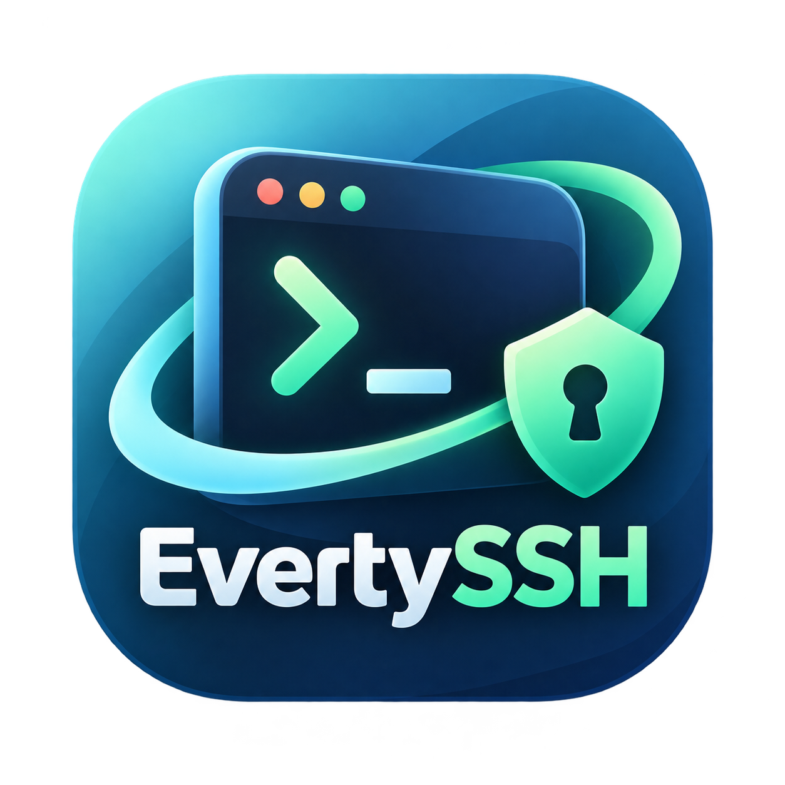

<p align="center">
  
</p>

<h1 align="center">EvertySSH ⚡</h1>

<p align="center">
  <b>Ультрабыстрый, минималистичный кроссплатформенный SSH-клиент нового поколения на Rust</b><br>
  Создан на базе собственного независимого интерфейсного движка <b>EvertyUI</b>
</p>

<p align="center">
  <a href="README.md"><b>English</b></a> • <a href="README.ru.md"><b>Русский</b></a>
</p>

<p align="center">
  
  
  
  
  
</p>

---

## 📖 О проекте

**EvertySSH** — это легковесный, безопасный и невероятно отзывчивый SSH-клиент для системных администраторов, DevOps-инженеров и разработчиков. 

Проект спроектирован с упором на максимальную производительность, моментальный запуск (<20 мс), отсутствие тяжелых зависимостей (Electron/Webview/Chromium) и полную аппаратную независимость благодаря рендерингу через программный буфер с векторной растеризацией.

Интерфейс оформлен в фирменном кибер-стиле **Everty** (*Cyber Midnight* `#090e1a` с бирюзово-мятными `#2dd4bf` и изумрудными `#34d399` акцентами).

---

## 🎨 EvertyUI — собственный интерфейсный движок для приложений Everty

**EvertyUI** — это собственный UI-фреймворк, разрабатываемый для создания нативных интерфейсов настольных приложений экосистемы **Everty**.

Проект появился из практической необходимости. По мере развития **EvertyDesk Next** стало очевидно, что интерфейс — это не просто набор кнопок, окон и текстовых полей. Это полноценная часть программной архитектуры, от которой зависят скорость отклика, потребление ресурсов, удобство разработки и возможность дальнейшего развития продукта.

Вместо постоянной адаптации сторонних интерфейсных решений под особенности каждого нового приложения было принято решение развивать собственный интерфейсный слой.

### Зачем нужен EvertyUI

Основная задача EvertyUI — предоставить единую технологическую основу для создания интерфейсов программ Everty без необходимости каждый раз разрабатывать графическую часть с нуля или подстраивать архитектуру приложения под ограничения стороннего фреймворка.

**EvertyUI решает ключевые задачи:**

1. **Независимость от сторонних UI-фреймворков.** Возможность самостоятельно развивать интерфейсные компоненты, управлять архитектурой и определять направление развития без зависимости от решений внешних разработчиков.
2. **Единая интерфейсная основа.** Использование общих элементов, принципов взаимодействия и визуального поведения в различных приложениях Everty.
3. **Контроль производительности.** Оптимизация отрисовки, обработка пользовательского ввода без лишних Win32 API вызовов (субмиллисекундный фреймтайм, 0% CPU в режиме простоя).
4. **Разделение интерфейса и бизнес-логики.** Графическая часть отвечает за взаимодействие с пользователем, тогда как основная функциональность реализуется независимыми асинхронными компонентами на Rust (Tokio, Russh, VTE).
5. **Повторное использование компонентов.** Разработанные элементы интерфейса используются в нескольких продуктах, сокращая объём повторяющейся работы.
6. **Развитие собственной программной экосистемы.** Новые приложения используют уже созданную интерфейсную инфраструктуру вместо формирования отдельного технологического стека для каждого продукта.

---

## ⚡ Ключевые возможности EvertySSH

### 🛡️ Проверка Host Key и защита от атак (known_hosts)
* **Аутентификация хоста:** автоматическое сохранение и сверка отпечатков публичных ключей серверов по базе `~/.ssh/known_hosts`.
* **Защита от спуфинга и MITM:** предотвращение перехвата трафика и подмены сервера злоумышленниками (например, через ARP-spoofing в локальной сети или публичном Wi-Fi).
* **Информативное предупреждение:** при несовпадении отпечатка ключа приложение блокирует соединение и выводит диалог проверки с SHA-256 fingerprint.

### 🖥️ Управление серверами (Hosts Manager)
* **Быстрое добавление и редактирование:** диалоговые окна с поддержкой горячих клавиш (`Ctrl+N`), группировка (`Production`, `Staging`, `Personal`).
* **Гибкая аутентификация:** системный `SSH-Agent` (включая Windows OpenSSH Authentication Agent), публичные/приватные ключи Ed25519/RSA или пароль.
* **Защита от случайного удаления:** аккуратное подтверждающее окно перед удалением хоста.
* **Хранение конфигурации:** чистый, понятный формат TOML (`~/.evertyssh/hosts.toml`).

### 🔑 Встроенный генератор и установщик SSH-ключей
* Генерация пар ключей **Ed25519** и **RSA-4096** с возможностью указания парольной фразы (passphrase) и комментариев.
* Выбор пути к существующему ключу через нативный системный проводник.
* **Установка ключа на сервер в 1 клик:** генерация ключа, сохранение на диск и мгновенная отправка команды установки в `authorized_keys` целевого сервера.

### ⌨️ Продвинутый VT100 / ANSI терминал
* **Высокая скорость:** поддержка ANSI escape-последовательностей, 256 цветов, TrueColor 24-bit.
* **Режимы DEC Private:** скрытие/показ курсора (`?25h`/`?25l`), альтернативный буфер экрана (`?1049h`/`?1049l` для корректной работы `vim`, `htop`, `nano`, `mc`).
* **Полноценный сплит-экран (Split Screen):** параллельный просмотр двух терминальных сессий в одном окне (`Ctrl+Alt+S`) с независимым вводом.
* **Поиск по терминалу (`Ctrl+F`):** подсветка совпадений, навигация `Enter` / `Shift+Enter`.
* **Выделение и буфер обмена:** выделение мышью, копирование/вставка через контекстное меню или горячие клавиши.

### 🌐 Полная поддержка русской раскладки для горячих клавиш
Все сочетания клавиш (`Ctrl+C`, `Ctrl+V`, `Ctrl+X`, `Ctrl+A`, `Ctrl+N`, `Ctrl+R`, `Ctrl+T`, `Ctrl+W`, `Ctrl+F`, `Ctrl+Alt+S`) работают абсолютно одинаково **как на английской, так и на русской раскладке клавиатуры**, отслеживаясь на физическом и логическом уровнях.

### 📜 История команд и дашборд сессий (SQLite)
* Локальная база `~/.evertyssh/history.db` сохраняет подключения и длительность сессий. Запись команд по умолчанию выключена и работает через [интеграцию с оболочкой](docs/SHELL_INTEGRATION.md), без записи нажатий клавиш.
* **Command Palette (`Ctrl+R`):** мгновенный умный поиск по выполненным ранее командам с подтверждением выполнения.
* **Информационный дашборд:** детальный просмотр сессии с метаданными и кнопкой быстрого повторного подключения.

### 🧩 Библиотека сниппетов
* Создание, редактирование и поиск собственных сниппетов с группировкой по категориям (`Docker`, `System`, `Deploy` и др.).
* Запуск сниппета в активном терминале по клику с защитным подтверждением перед выполнением опасных команд (`rm -rf`, `reboot`, `shutdown`, `dd`).

### 🔒 Безопасность и настройки
* **Защита мастер-паролем:** блокировка интерфейса с Argon2id и случайной солью. Пароли серверов и ключевые фразы хранятся в системном хранилище учётных данных; в TOML записываются только ссылки на них.
* **Вкладка «О нас»:** прямые ссылки на экосистему Everty, Telegram-канал, репозиторий и контакты разработчика.
* **Двуязычный интерфейс (RU / EN):** мгновенное переключение языка в 1 клик прямо из шапки приложения или через вкладку настроек.
* **Резервное копирование:** зашифрованный файл `.evertybackup` с серверами, паролями и настройками. Пароль копии задаётся отдельно во вкладке «Резервная копия» и повторяется при экспорте. При импорте также поддерживаются старые JSON-копии v1; новые копии всегда шифруются. Сниппеты и история остаются в SQLite, файлы приватных SSH-ключей в копию не входят.

---

## ⌨️ Горячие клавиши

| Сочетание (EN) | Сочетание (RU) | Действие |
|---|---|---|
| `Ctrl + N` | `Ctrl + Т` | Добавить новый сервер |
| `Ctrl + R` | `Ctrl + К` | Палитра команд / Поиск по истории |
| `Ctrl + T` | `Ctrl + Е` | Быстрое подключение / Новая сессия |
| `Ctrl + W` | `Ctrl + Ц` | Закрыть активную сессию / вкладку |
| `Ctrl + F` | `Ctrl + А` | Поиск по буферу терминала |
| `Ctrl + Alt + S` | `Ctrl + Alt + Ы` | Включить / выключить разделение экрана (Split Screen) |
| `Ctrl + V` | `Ctrl + М` | Вставить из буфера обмена (в терминал или активное поле) |
| `Ctrl + C` | `Ctrl + С` | Скопировать выделение / Сигнал прерывания (SIGINT) |
| `Ctrl + X` | `Ctrl + Ч` | Вырезать текст из поля ввода |
| `Ctrl + A` | `Ctrl + Ф` | Выделить весь текст в активном поле |
| `Shift + Insert` | `Shift + Insert` | Альтернативная вставка в терминал |
| `Tab` | `Tab` | Переход между полями ввода |
| `Enter` | `Enter` | Подтвердить ввод / выполнить команду |
| `Esc` | `Esc` | Закрыть модальное окно / отмена |

---

## 🚀 Сборка и запуск

При первом запуске старые открытые пароли автоматически переносятся в Windows
Credential Manager, macOS Keychain или Linux Secret Service. Если системное
хранилище недоступно, запуск останавливается, исходный файл сохраняется. В Linux
нужен разблокированный провайдер Secret Service, например GNOME Keyring или
KWallet с включённым интерфейсом Secret Service.

Мастер-пароль блокирует интерфейс; метаданные серверов и SQLite он не шифрует.
При импорте копии серверы объединяются по ID, настройки восстанавливаются,
локальный мастер-пароль сохраняется. Повреждённая конфигурация не заменяется
пустой; исправьте её и перезапустите приложение. Сохранение выполняется атомарно
с проверкой внешних изменений файла.

### Требования
* Rust 1.89+ (stable toolchain)
* Cargo

### Сборка релизной версии:
```bash
# Клонирование репозитория
git clone https://github.com/vaalimusic/EvertySSH.git
cd EvertySSH

# Сборка оптимизированного бинарного файла
cargo build --release --bin everty-ssh

# Исполняемый файл появится в:
# target/release/everty-ssh (или target/release/everty-ssh.exe на Windows)
```

### Запуск в режиме разработки:
```bash
cargo run -p everty-ssh
```

---

## 📚 Документация

Подробные руководства доступны в директории [`docs/`](docs/):
* [Архитектура приложения и движка EvertyUI](docs/ARCHITECTURE.md)
* [Безопасность и проверка ключей хоста (known_hosts)](docs/SECURITY.md)
* [Полная таблица горячих клавиш](docs/KEYBOARD_SHORTCUTS.md)

---

## 👨‍💻 Автор и контакты

**Arthur Valiev**

* 🌐 Официальный сайт: [Everty.ru](https://everty.ru)
* 🖥️ Продукты EvertyDesk: [desk.everty.ru](https://desk.everty.ru)
* ✈️ Telegram канал: [@Everty_web](https://t.me/Everty_web)
* ✉️ Связь по электронной почте: [info@everty.ru](mailto:info@everty.ru)
* 🐙 GitHub репозиторий: [github.com/vaalimusic/EvertySSH](https://github.com/vaalimusic/EvertySSH)

---

## 📄 Лицензия

Проект распространяется под свободной лицензией **MIT**. Подробности в файле [LICENSE](LICENSE).
