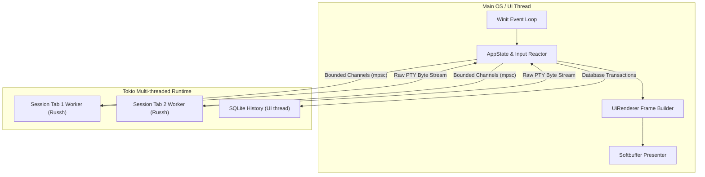

# EvertySSH & EvertyUI Architecture 🏛️

This document outlines the technical architecture, design patterns, and engineering principles behind **EvertySSH** and the **EvertyUI** framework.

---

## 📐 System Overview

EvertySSH is structured as a multi-crate Rust workspace:

```
EvertySSH/
├── Cargo.toml                  # Workspace root configuration
├── crates/
│   ├── everty-ui/              # Custom lightweight vector UI engine
│   │   ├── src/
│   │   │   ├── geometry.rs     # Logical/Physical coordinate systems
│   │   │   ├── dpi.rs          # Sub-pixel DPI snapping & scaling
│   │   │   ├── paint.rs        # Paint command list builder
│   │   │   ├── text.rs         # Text layout & font glyph shaping
│   │   │   ├── renderer.rs     # Software rasterizer & blitter
│   │   │   └── widgets/        # Buttons, text fields, popups, scrollbars
│   │   └── Cargo.toml
│   └── everty-ssh/             # Application logic & SSH terminal client
│       ├── src/
│       │   ├── main.rs         # Event loop (Winit + Softbuffer)
│       │   ├── app.rs          # Application state & hit-testing reactor
│       │   ├── app/            # Sessions, settings, history, dialogs and regression tests
│       │   ├── config_store.rs # Atomic configuration and credential migration
│       │   ├── secrets.rs      # Injectable OS credential store
│       │   ├── backup.rs       # Authenticated password-encrypted backups
│       │   ├── paste.rs        # Paste normalization and bracket encoding
│       │   ├── ui.rs           # Frame compositing & widget rendering
│       │   ├── ssh.rs          # Tokio async SSH worker & known_hosts
│       │   ├── terminal.rs     # VT100 / ANSI escape state machine
│       │   ├── db.rs           # SQLite history database
│       │   ├── config.rs       # TOML configuration & master password
│       │   └── i18n.rs         # RU/EN localization system
│       └── Cargo.toml
└── docs/                       # Architectural & security documentation
```

---

## ⚡ Threading & Concurrency Model



1. **Network isolation:** SSH runs on Tokio. Configuration, credential-store dialogs, SQLite operations and backup cryptography currently run synchronously from UI actions.
2. **Bounded output:** SSH output is split into at most 16 KiB chunks and sent through a shared 128-event Tokio channel. Async workers await capacity. Each UI poll handles at most 64 events with a 4 ms budget checked between events. Input uses a separate 128-message channel; saturation is reported instead of spawning unbounded send tasks.
3. **Decoupled PTY Resizing:** Terminal rows and columns recalculate instantaneously on window resize; a background channel notifies the remote PTY (`SIGWINCH`) without blocking frame rendering.

---

## 🎨 EvertyUI Vector Engine

EvertyUI is a purpose-built software rendering UI engine designed to eliminate the overhead of Webviews, GPU driver incompatibilities, and heavy frameworks.

### Rendering Pipeline

1. **Geometry Layout:** All coordinates, padding, and container sizes are computed in high-precision `LogicalPoint` and `LogicalRect` units.
2. **Sub-pixel DPI Snapping:** Coordinates are converted to physical device pixels (`PhysicalPx`) once with deterministic half-open boundary snapping to prevent blurry borders or 1px seams at fractional DPI scales (125%, 150%, 175%, 200%).
3. **Typography & Shaping:** Text shaping is powered by `cosmic-text`. Layouts are cached in a fixed-capacity LRU memory buffer (`layout_cache`) so static strings and server titles do not trigger font fallback sweeps.
4. **Vector Rasterization:** Anti-aliased rounded rectangles, borders, shadows, and vector SVG glyphs are rendered into a 32-bit linear RGBA frame buffer and presented to the OS window via `softbuffer`.

---

## 🖥️ Terminal Emulator Subsystem

The terminal emulator in `crates/everty-ssh/src/terminal.rs` implements a clean ANSI / VT100 parser:

* **State Parsing:** Processes standard escape codes (`ESC [ ... m` for SGR colors, cursor positioning `H`, line erasure `2K`, scroll regions `r`).
* **DEC Private Modes:**
  * `?2004h` / `?2004l` — Bracketed paste.
  * `?25h` / `?25l` — Cursor show / hide.
  * `?1049h` / `?1049l` — Alternate screen buffer switching (enabling full-screen CLI tools such as `vim`, `htop`, `mc`, `nano`).
* **Scrollback Buffer:** Configurable history buffer (up to 100,000 lines) with sub-string regex-style search (`Ctrl+F`).
* **Split View Geometry:** Computes character metrics for dual-viewport horizontal splits (`Ctrl+Alt+S`) with separate cursor state machines.

---

## 💾 Storage & Persistence

1. **`~/.evertyssh/hosts.toml`:**
   Stores server profiles, credential references and UI preferences. Passwords and key passphrases are in the OS credential store. Atomic writes and snapshot checks protect configuration integrity.
2. **`~/.evertyssh/history.db`:**
   High-performance embedded SQLite database using WAL (Write-Ahead Logging) mode. Stores session timestamps, durations, and command execution logs for the `Ctrl+R` command palette.
3. **`~/.ssh/known_hosts`:**
   Adheres to the standard OpenSSH `known_hosts` format for cryptographic server authentication.

## Tests and CI

`AppState::new` uses a temporary configuration store, an injected in-memory
credential store and an in-memory SQLite database under `cfg(test)`. Tests do not
open the real user configuration or keychain. A separately ignored credential
integration test can be run explicitly against synthetic temporary credentials.

The reusable Checks workflow runs formatting, correctness/suspicious Clippy
checks, workspace tests and builds on Windows, Linux and macOS. Release packaging
depends on those checks. Bash hook tests use an isolated shell without startup
profiles or a persistent history file.
