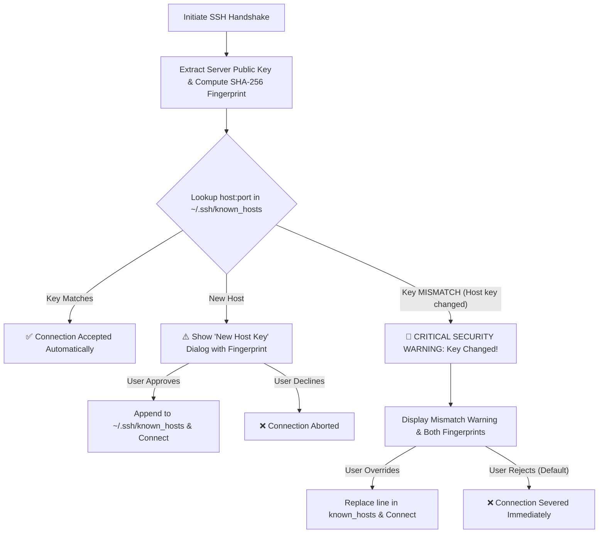

# Security Architecture & Policies 🛡️

Security is a foundational design goal of **EvertySSH**. This document details the cryptographic safeguards, host key verification mechanisms, and credential protection implemented in the client.

---

## 🔒 1. Host Key Verification (`known_hosts`)

### The Threat Model: ARP Spoofing & MITM
In local networks (office LANs, co-working spaces, home networks) and untrusted public Wi-Fi access points, attackers can execute **ARP-spoofing** or DNS cache poisoning. By impersonating the router's IP address or the target host, an attacker can position themselves as a Man-in-the-Middle (MITM). Without host key verification, an SSH client would silently connect to the attacker's fake SSH server, exposing credentials and session traffic.

### EvertySSH Defense Mechanism
EvertySSH integrates directly with the system's standard OpenSSH `known_hosts` file (`~/.ssh/known_hosts`):

* **Standard Format:** Stored using standard OpenSSH format compatible with OpenSSH CLI tools.
* **Deterministic Removal:** Outdated or regenerated host keys can be removed directly with a single click.

---

## 🔑 2. SSH Key Studio & Cryptography

* **Algorithms Supported:**
  * **Ed25519:** High-speed Edwards-curve Digital Signature Algorithm (256-bit key length, equivalent to RSA-3072+ with immune resistance to timing attacks).
  * **RSA-4096:** 4096-bit asymmetric RSA key pair with PKCS#8 encoding.
* **Passphrase Protection:** Private keys generated within EvertySSH can be encrypted with an AES-256 password passphrase.
* **System SSH-Agent Integration:** EvertySSH interfaces with the native `SSH_AUTH_SOCK` (on Linux/macOS) and the Windows OpenSSH Named Pipe (`\\.\pipe\openssh-ssh-agent`) without storing plaintext private keys in memory.

---

## 🛡️ 3. Master Password Protection

EvertySSH supports an optional master password lock on startup:
* **Storage:** Passwords are never stored in plaintext. Verification uses cryptographic salted SHA-256 hashes.
* **Session Guard:** When locked, the client blocks access to server connection profiles, saved credentials, and command history until unlocked.

---

## ⚠️ 4. Dangerous Command Interceptor

EvertySSH parses commands dispatched from Snippets or Command History:
* Flags dangerous operations such as:
  * Recursive filesystem deletion (`rm -rf`, `rm -r /`, `rmdir`)
  * Storage device overwrite (`dd if=`, `mkfs`, `fdisk`, `parted`)
  * System reboot or halt (`reboot`, `shutdown`, `init 0`, `init 6`)
  * Process termination (`kill -9`, `killall`)
* Displays a high-visibility amber/red warning dialog requiring explicit user confirmation before sending the keystrokes to the active terminal.

---

## 📮 Reporting Vulnerabilities

If you discover a potential security vulnerability in EvertySSH, please report it responsibly by contacting the maintainer:

* **Email:** [info@everty.ru](mailto:info@everty.ru)
* **Telegram:** [@Everty_web](https://t.me/Everty_web)

Please include a detailed description of the issue, reproduction steps, and impact assessment. Vulnerabilities will be addressed with high priority.
